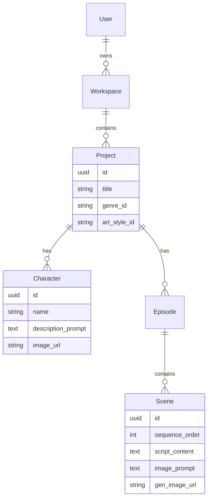

# 🔌 API 상세 명세 가이드 (API REFERENCE)

Backend API의 주요 리소스와 엔드포인트에 대한 요약입니다.
상세한 Request/Response 스키마는 서버 실행 후 Swagger UI (`http://localhost:8000/docs`)를 참고하세요.

## 1. Projects (프로젝트)

핵심 작업 단위인 프로젝트를 관리합니다.

- `GET /api/v1/projects`: 프로젝트 목록 조회
- `POST /api/v1/projects`: 새 프로젝트 생성 (장르, 제목 등 설정)
- `GET /api/v1/projects/{project_id}`: 프로젝트 상세 조회
- `PUT /api/v1/projects/{project_id}`: 프로젝트 정보 수정
- `DELETE /api/v1/projects/{project_id}`: 프로젝트 삭제

## 2. Characters (캐릭터)

프로젝트에 캐스팅된 등장인물을 관리합니다.

- `POST /api/v1/projects/{project_id}/characters`: 캐릭터 생성 요청
- `GET /api/v1/projects/{project_id}/characters`: 캐릭터 목록 조회
- `POST /api/v1/characters/generate`: (AI) 캐릭터 이미지 생성 트리거
- `POST /api/v1/characters/{character_id}/retry`: (AI) 캐릭터 이미지 재생성

## 3. Episodes & Scenes (스토리보드)

웹툰의 에피소드와 각 컷(Scene)을 관리합니다.

- `POST /api/v1/projects/{project_id}/episodes`: 에피소드 생성
- `GET /api/v1/episodes/{episode_id}`: 에피소드 상세 (Scenes 포함)
- `POST /api/v1/episodes/{episode_id}/generate-storyboard`: (AI) 스크립트 기반 컷 분할 및 초안 생성
- `PUT /api/v1/scenes/{scene_id}`: 특정 컷의 프롬프트나 데이터 수정

## 4. Styles (화풍)

- `GET /api/v1/styles`: 사용 가능한 화풍 스타일 목록 조회
- `POST /api/v1/styles/custom`: 사용자 정의 화풍 등록 (Reference Image 업로드)

## 5. Assets (자산)

- `POST /api/v1/assets/upload`: 이미지 등 파일 업로드
- `GET /api/v1/assets/{filename}`: 파일 접근 (Static serving)

---

## DB ERD (간략)

